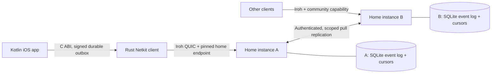
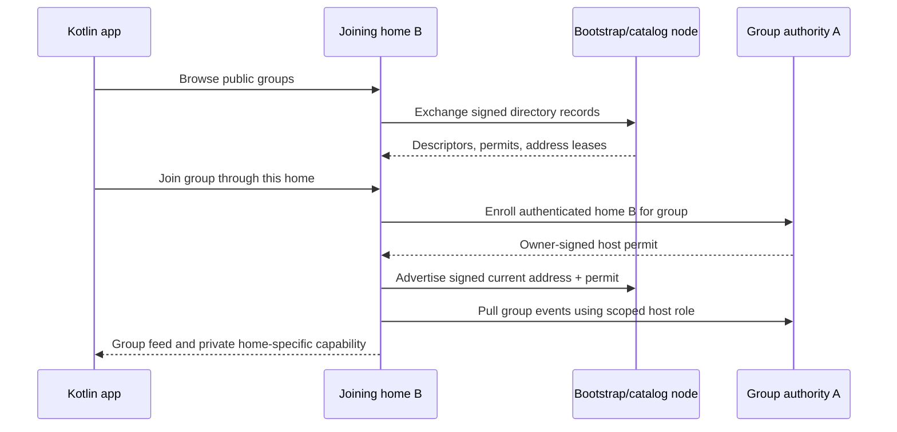

# Architecture

## Roles

An **Iroh endpoint** is a transport identity. A **home instance** accepts a client's publication, validates it, signs its acceptance, and durably stores it. A **relay** helps transport packets when direct connectivity fails; it is not a home instance, content store, moderator, or federation authority.

Each instance owns a stable Ed25519/Iroh transport key. Each app installation owns a separate stable author key, while its client transport endpoint is ephemeral. Author and transport identities are deliberately separate. Names and anonymous presentation are properties of signed posts, not authentication identities.

A community has an opaque, globally namespaced string, normally `<founding instance public key>/neighborhood`. Multiple instances may host that same community by explicit configuration. A founding namespace prevents accidental naming collisions; it does not impose a central runtime coordinator. Each participating instance controls its own membership capabilities, peer allowlist, local moderation, and availability. Trusting an origin for a community authorizes it to admit publications into that community.

## Publication

1. The user writes a post, reply, or vote. The app calls the Rust preparation operation with structured fields.
2. Rust validates the action and creates an immutable author-signed event with a random nonce and monotonically increasing author sequence.
3. The app stores the next author sequence in Keychain, then atomically saves the event in its local outbox before acknowledging local creation. A sequence gap after a failed local write is allowed; sequence reuse is not.
4. A sync pass sends the exact event to its designated home, using the private community capability over Iroh's encrypted, endpoint-authenticated connection.
5. The home checks the capability, signature, community, home, action/target relationship, clock bounds, author sequence uniqueness, rate limit, and capacity. It signs an acceptance envelope and commits it to SQLite with EXTRA synchronous rollback-journal transactions alongside the deletion guard.
6. Only after an acceptance receipt naming the same event ID does the client remove that outbox entry. A lost receipt is safe: identical resubmission returns the existing receipt without appending a second event.
7. The app fetches the materialized feed. Local bookmarks and local hidden-post preferences remain local. Pending events are overlaid on the cached feed until acknowledged.

These are at-least-once delivery semantics with idempotent event IDs, not exactly-once network delivery.

## Federation

Instances pull bounded pages from explicit private peers and automatically discovered, authority-permitted public-group hosts. Incoming federation reads authenticate the peer's Iroh endpoint key; a community token alone never grants federation access. A peer's explicit community scope or verified group host permit limits which log entries it can read. Each imported envelope must also have a valid author signature and home signature, and its origin must independently have explicit local trust or the group authority's valid host permit for that public group. A trusted intermediary does not grant transitive trust to an unknown origin.

A SQLite cursor is an ingestion sequence local to the serving instance. It is not an event ID or a universal ordering. Every server start creates a fresh replication generation; a changed generation forces a bounded rescan from zero. This deliberately spends some bandwidth to handle restarts and offline database restores without silently skipping an earlier range of sequence numbers. Duplicates do not create new log entries. Same-generation, same-authorized-scope sync resumes at its persisted cursor. A changed scope/policy hash also forces replay from zero, because a prior scan may have advanced over rows for a group that was not joined yet.

A page's imports and the peer cursor commit in one transaction. Invalid signatures, scope violations, conflicting attestations, author sequence conflicts, or storage failure leave that page and cursor uncommitted. Operators must repair or remove a peer that continually serves an invalid page. The loop attempts all configured peers even when one fails, and limits work per peer per cycle.

Forwarding loops converge because imported event IDs are unique. Public catalog records gossip through bootstrap nodes and discovered hosts. Content remains pull-replicated. There is no global consensus, global username registry, exhaustive worldwide index, or mobile inbound listener.

### Handling denied origins

The importer checks the page order, community scope and envelope signatures before applying local peering policy. An invalid signature or an entry outside the peer’s configured communities rejects the page and leaves the cursor in place.

Within scope, the importer skips valid entries from blocked origins. With a covenant policy configured, it also skips an entry if either the sending peer or the originating home lacks approval for that community. A suspended party can supply only signed deletions and erased records. Entries that pass this filter still need the applicable origin authorization, such as a valid group host permit. The importer commits accepted entries and the new cursor together, so skipped entries do not hold up other origins. Changing the blocklist or peering policy triggers a rescan.

## Locality and worldwide groups

A public group maps to its own globally unique event community. Its immutable owner-signed descriptor contains a name, description, category, optional coarse city/region/country, and explicit open-federation policy. The cryptographic ID distinguishes same-named groups operated by different homes. Cities are labels, not verification of residence. A null locality means worldwide.

Discovery sources do not grant trust. Each descriptor and host permit is checked against the group's owner; each expiring address is checked against its permitted host. Only locally hosted groups enter automatic replication scopes. Operator blocklists apply to discovery, enrollment contact, federation reads, and imported origins. Private communities cannot become public through a catalog advertisement. The app itself is not a federation host.

See [the full group protocol and operating model](groups.md). The group catalog is the connected discovery component visible through configured seeds, not a predeployed global service.

## Reads and local state

The home materializes posts/replies/votes from its validated event set and applies its local hidden-event policy. The Rust client pins the home endpoint; the feed is an authenticated server projection, not an independently verified cryptographic inclusion proof. Client-side cache and outbox survive process restarts. Cached bookmarks/hides remain scoped to their home/community when switching connections. A cached feed may lag while offline. The UI explicitly distinguishes demo mode, live mode, pending uploads, and errors.

Posts are sorted by signed home acceptance time and event ID, not arrival order at the replica. Replies use the same stable ordering. A vote's greatest `(author sequence, event ID)` for a target/author wins, including a value of zero to clear it. Author deletion tombstones apply regardless of arrival order. Local moderation never rewrites signed events or automatically propagates to peers.

## Mobile lifecycle

The app initiates outbound requests; servers provide durable availability while phones sleep. iOS uses foreground polling, system-scheduled app refresh and short runtime grants to finish queued uploads. macOS syncs while the application is running, including when its window is closed. Both clients serialize foreground and background changes to their persistent outboxes. Phones can be suspended between passes. Messages wait at the home for the recipient’s next sync.

## Boundaries

The native apps offer public-home enrollment, a private invitation and a local demo. Home-feed posts may include a chosen city and rounded coordinates. A posting area makes no claim about where the author lives. [Location sharing](../public-home.md#location-behavior)

## User-owned portability

Transport v5 carries root-signed account/device/home state and encrypted
recovery. A legacy author key becomes account authority; new content uses separate device
keys and per-device counters. Local signed receipts permit offline export. Destination
private-history storage preserves original envelopes without adding them to public
federation logs. The old home need not approve or participate in recovery. See
[ownership architecture](../ownership.md) for the complete model and operational boundaries.
